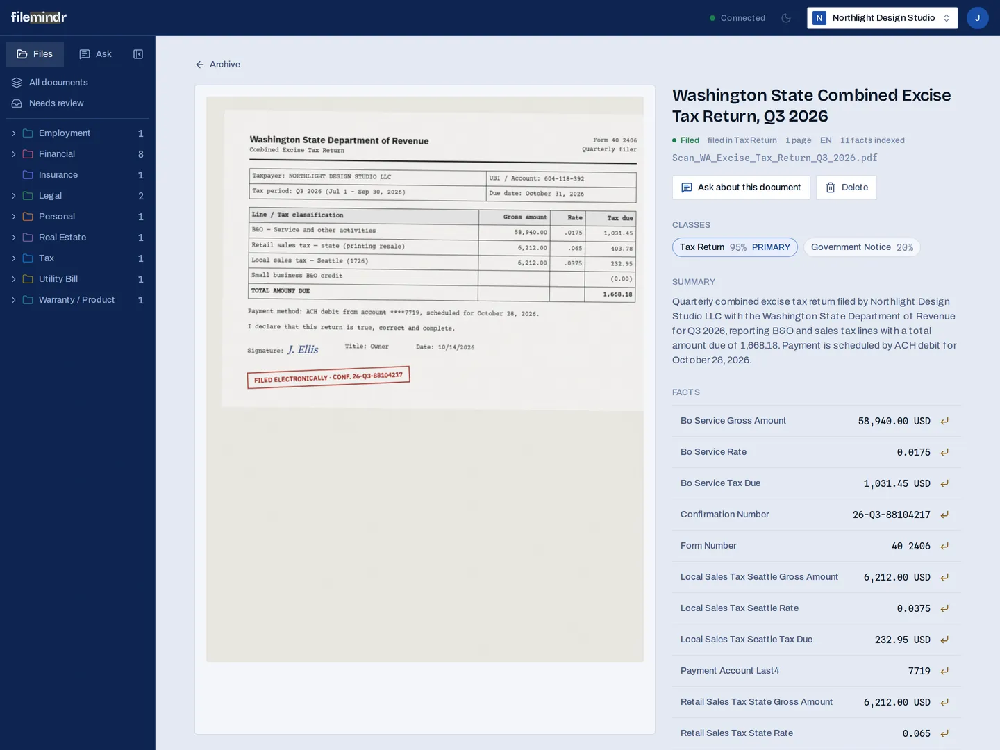
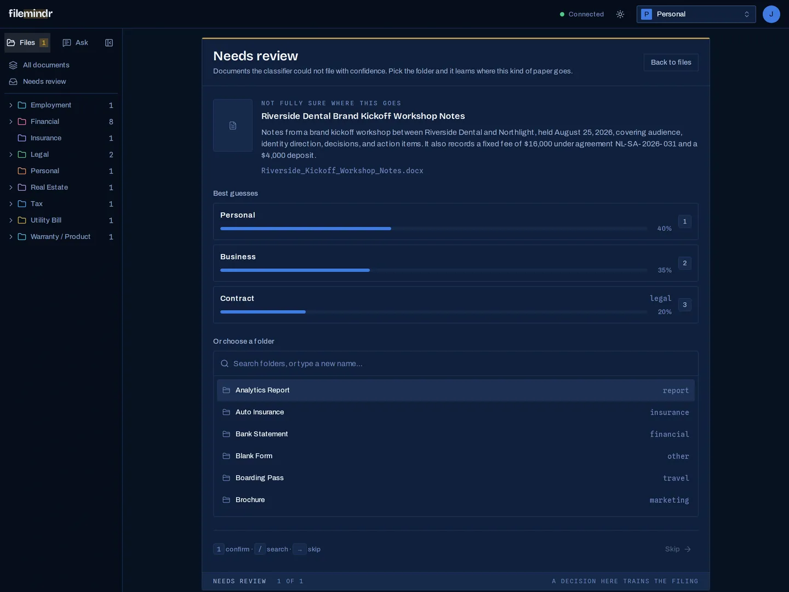

# OCR and document processing

Before retrieval can work, documents have to become text, and then structured facts. This page covers Filemindr's ingest pipeline: [`app/services/ocr.py`](https://github.com/abby306/filemindr/blob/main/app/services/ocr.py), [`app/services/extraction.py`](https://github.com/abby306/filemindr/blob/main/app/services/extraction.py) and [`app/services/embeddings.py`](https://github.com/abby306/filemindr/blob/main/app/services/embeddings.py).

## Pipeline stages

Every upload becomes a `documents` row and moves through explicit statuses:

```text
received → ocr_done → extracted ─┬→ indexed
                                 └→ needs_review (still embedded and searchable)
any stage → failed (with the error recorded)
```

Each stage appends `started` / `succeeded` / `failed` rows to `processing_events`, with duration and details such as engine, page count and cache hit. To find out why a document failed, you query that table instead of re-running the pipeline. Uploads return immediately. A bounded worker pool (`PIPELINE_WORKERS`, default 3) processes documents in the background.

## Supported formats and OCR routing

| Input | Engine | Notes |
|---|---|---|
| PDF with a usable text layer | PyMuPDF | Page text plus block-level bounding boxes |
| Scanned / image-only PDF | Google Cloud Vision | Each page rasterized at 200 DPI, OCR'd in parallel |
| PNG / JPEG | Google Cloud Vision | Phone photos and scans; block bounding boxes kept |
| DOCX | python-docx | Paragraph text; treated as one page, no bounding boxes |

**Text-layer probe.** A PDF counts as having a usable text layer if it yields at least 100 characters in total *and* at least 20 per page on average. Scanned PDFs usually yield almost nothing. This check avoids paying for OCR on born-digital PDFs and still catches scans saved as PDF.

**Partial failure tolerance.** On a multi-page scan, a page that keeps failing after retries is recorded in `failed_pages` and left empty. Only an all-pages failure fails the document. Transient Vision errors (429, 5xx, timeouts) are retried with backoff.

**Caching and dedup.** OCR output is cached by the file's SHA-256 hash, so identical bytes are never OCR'd twice. Uploads are also deduplicated per account by `(account_id, file_hash)`.

Language is detected per document (Vision's own detection, or `langdetect` as a fallback). Retrieval is currently tuned for English (see [Hybrid search](hybrid-search.md)).



*Screenshots are from Filemindr Cloud, the hosted product built on this open-source core, using a fictional demo company. The self-hosted web app runs the same pipeline, answers and citations with an earlier visual design.*

## Structured extraction with an LLM

One JSON-mode call (DeepSeek `deepseek-chat` by default, `temperature=0`) reads the OCR text and returns:

- **title** and **summary**
- **classes**: multi-label, with confidence, chosen from the account's class catalog (hierarchical, for example *Financial → Invoice*; accounts can add their own)
- **entities**: people and organizations
- **dates** with a role: `issued`, `due`, `expiry`, `event`, `mentioned`
- **typed facts**: label, value, numeric value and unit, typed as `money`, `number`, `date`, `id` or `string`
- **atomic facts**: short self-contained sentences that make sense on their own, which are the main unit retrieval works with

**Long documents** are split into page windows of about 14,000 characters (whole pages only) and extracted in parallel. The results are merged with entities deduplicated, so the whole document is read, not just its first pages.

**Lenient parsing.** The parser never trusts the model's output shape. Unknown enum values fall back to defaults, unparseable dates become null, and near-miss class slugs like `financial/invoice` are normalized. A noisy response loses some fields instead of failing the document. The raw response is stored in `documents.extraction_raw` for debugging.

## Provenance: page and bounding box per fact

Each atomic fact is matched back to an OCR block: if at least 50% of the fact's tokens appear in a block, that block's polygon becomes the fact's `bbox`. That's what lets the UI highlight the exact clause behind a citation. It works for both text-layer PDFs and Vision OCR because both produce block polygons in the same shape. Typed facts carry a page number. DOCX files have no page geometry.

## Confidence routing and human review

A document goes to **Needs review** instead of `extracted` when:

- it has no class, or its top class confidence is below **0.5**, or
- it's **ambiguous**: the top class is below 0.8, a runner-up of at least 0.3 is within 0.15 of it.

Documents waiting for review are still embedded and searchable. The review deck shows the best guesses with their confidence, and filing one is a single keystroke.



## Embedding and indexing

The final stage embeds every atomic fact and the summary locally with `bge-base-en-v1.5` (normalized 768-d vectors, batch size 32) into pgvector columns with HNSW cosine indexes. Re-running the stage overwrites the vectors in place, so re-indexing is safe.

## External services and privacy

OCR of scans and images uses **Google Cloud Vision**, and extraction uses **DeepSeek** (or another OpenAI-compatible endpoint set by `DEEPSEEK_BASE_URL`; only DeepSeek has been tested). Document text is sent to those providers. Born-digital PDFs and DOCX files skip Vision entirely. Embedding runs locally. See [Configuration](../configuration.md).

Related: [Hybrid search](hybrid-search.md) · [Agentic RAG and citations](agentic-rag-citations.md)
