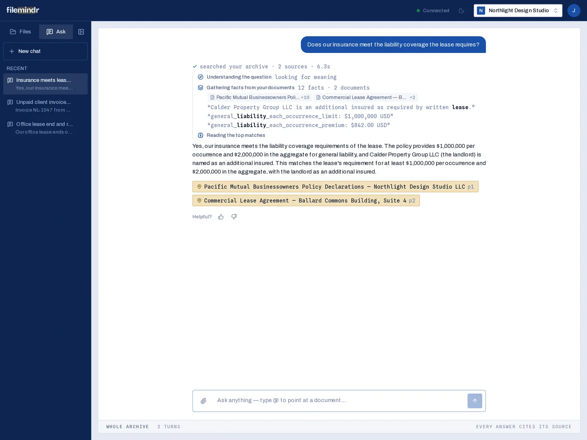

# Filemindr: open-source RAG and document intelligence

Filemindr is a self-hostable, open-source <strong>retrieval-augmented generation (RAG)</strong> application for documents. It OCRs PDFs, scans, photos and Word files, extracts a structured record of each one with an LLM, files them into an archive, and answers questions with <strong>page-level source citations</strong>.

Filemindr's source code is at [github.com/abby306/filemindr](https://github.com/abby306/filemindr) under the AGPL-3.0 license. It is built with **Python / FastAPI**, **PostgreSQL 16 + pgvector**, and a **Next.js** web app.

## What Filemindr does

1. **Ingests documents.** It accepts PDF (with or without a text layer), DOCX, PNG and JPEG. Text-layer PDFs are read with PyMuPDF. Scanned pages and images go through Google Cloud Vision OCR. See [OCR and document processing](features/ocr-document-processing.md).
2. **Extracts structure once.** One JSON-mode LLM pass turns each document into a *card*: classes with confidence, a summary, entities, dated events, typed facts (money, numbers, ids) and self-contained atomic facts. Each fact keeps its page, and atomic facts also keep a bounding box.
3. **Indexes it in Postgres.** Atomic facts and summaries are embedded locally with `bge-base-en-v1.5` into pgvector HNSW indexes. Facts also get a full-text `tsvector` with a GIN index.
4. **Retrieves with hybrid search.** Structured, lexical and two-stage vector retrievers run on every query. They are merged with weighted Reciprocal Rank Fusion and reranked by a cross-encoder. See [Hybrid search and reranking](features/hybrid-search.md).
5. **Answers agentically, with citations.** An LLM with `find_documents`, `search` and `read_page` tools decides how to dig, and it can only cite facts it was given. See [Agentic RAG and citations](features/agentic-rag-citations.md).

## How it differs from a "chat with your PDF" tool

| Typical PDF chatbot | Filemindr |
|---|---|
| Splits raw text into chunks and embeds them | Extracts typed facts, dates, entities and atomic facts at ingest, then retrieves over that structure |
| Vector similarity only | Vector + Postgres full-text + structured lookup, fused with RRF, then cross-encoder reranking |
| One-shot prompt with top-k chunks | Bounded agent loop that can locate a document, scope a search, or read a raw page |
| Citations are often a filename | Citations resolve to document and page, with the exact region highlighted where available |
| A chat window | An archive with auto-filing, a human review queue, a document view and analytics |

## Who should use it

- **Developers learning or comparing RAG architectures.** The retrieval engine is about 570 lines of readable Python with an offline test suite.
- **Small teams that want a self-hosted document AI** for invoices, receipts, contracts, statements and policies, with an HTTP API they control.
- **Builders who need a starting point** for document question answering with provenance, and who are comfortable extending auth and deployment.

## Technology at a glance

| Layer | Technology |
|---|---|
| Backend | Python 3.12, FastAPI, SQLAlchemy 2, Alembic |
| Storage & search | PostgreSQL 16, pgvector (HNSW, cosine), Postgres full-text search (GIN) |
| Local models | `BAAI/bge-base-en-v1.5` embeddings, `BAAI/bge-reranker-base` cross-encoder (CPU) |
| Hosted models | DeepSeek (extraction, OpenAI-compatible), Gemini 2.5 Flash (answers), Google Vision (OCR for scans), optional GPT-4o |
| Frontend | Next.js 16, React 19, TypeScript, Tailwind CSS 4 |

## Current limitations

Filemindr is self-hostable but **not offline**: extraction, answering and OCR of scans call hosted APIs, so document text is sent to those providers. Authentication is dev-grade, so put real auth in front of any internet-facing instance. Background processing is in-process and isn't durable across restarts. The [FAQ](faq.md) covers these limits in more detail.

## Next steps

- [Getting started](getting-started.md): run it locally in about 15 minutes.
- [Architecture](architecture.md): how FastAPI, PostgreSQL, pgvector and the RAG pipeline fit together.
- [Source on GitHub](https://github.com/abby306/filemindr): code, issues and contributions.
